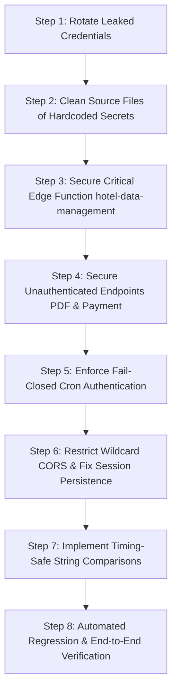

# HOTELMANTRI — P0 SECURITY RECONNAISSANCE REPORT
**Phase 0: Source-Verified Read-Only Security Audit**  
**Repository:** HotelMantri (React/TypeScript, Vite, Express, Supabase)  
**Date of Audit:** October 10, 2026  
**Auditor:** Implementation Engineer (under Senior Full-Stack Developer & Project Manager)  
**Status:** Audit Complete — Zero Code Modifications Applied (Read-Only)

---

## 1. Executive Summary

A comprehensive, source-verified read-only security audit was conducted across the HotelMantri repository. The audit focused on core backend security postures:
1. Authentication & tenant isolation (`server/middleware/auth.js`)
2. Supabase client configuration & credential resolution (`server/supabaseClient.js`, `src/lib/supabase.ts`)
3. Payment gateways & signature verification (`server/index.js`, `server/razorpayService.ts`, `vite.config.ts`, `src/lib/razorpay.ts`)
4. Sensitive route modules & document delivery (`server/routes/reservations.js`, `server/routes/notifications.js`, `server/routes/channels.js`, `server/routes/aiosell.js`)
5. Supabase Edge Functions (`supabase/functions/*`)
6. CORS, request parsing, error handling, and Git repository hygiene.

### Summary of Posture:
- **Core Tenant Isolation is Strong:** The primary authentication middleware (`server/middleware/auth.js:resolveAuthorizedHotel`) implements robust tenant isolation. Regular users and hotel admins cannot tamper with `hotelId` or `x-hotel-id` parameters; attempts to access cross-tenant data trigger `403 HOTEL_ACCESS_DENIED`.
- **Critical Perimeter & Credential Deficits Identified:** Several perimeter endpoints and configuration files contain critical vulnerabilities:
  - Hardcoded Super Admin credentials present in the server's Supabase client fallback (`server/supabaseClient.js:44-45`).
  - Hardcoded Razorpay Key Secret and Key ID present in the build configuration (`vite.config.ts:8-9`).
  - Completely unauthenticated and unvalidated Razorpay order creation and payment verification endpoints accepting arbitrary client amounts (`server/index.js:124-198`).
  - An unauthenticated edge function (`supabase/functions/hotel-data-management/index.ts`) allowing arbitrary destruction of hotel storage assets and Supabase auth users with service role privileges.
  - Direct guest PII exfiltration via an unauthenticated PDF stream endpoint (`server/routes/reservations.js:878-936`).
  - A flawed WhatsApp cron endpoint with an environment-dependent authentication bypass (`server/routes/notifications.js:788-795`).
  - Unrestricted wildcard CORS (`server/index.js:24`).

All findings below are source-verified with exact line references. No production requests, schema migrations, or code changes were executed during this phase.

---

## 2. Source-Verified Findings

| ID | Title | File Reference | Severity | Verification Status |
| :--- | :--- | :--- | :--- | :--- |
| **SEC-01** | Hardcoded Super Admin Credentials in Service Client Fallback | `server/supabaseClient.js:42-49` | **Critical** | Confirmed |
| **SEC-02** | Hardcoded Razorpay API Key ID & Secret in Build Config | `vite.config.ts:8-9` | **Critical** | Confirmed |
| **SEC-03** | Unauthenticated Arbitrary Order Creation & Incomplete Signature Verification | `server/index.js:124-198`, `server/razorpayService.ts:33-85` | **Critical** | Confirmed |
| **SEC-04** | Broken Access Control & Arbitrary Resource Deletion in Edge Function | `supabase/functions/hotel-data-management/index.ts:15-126` | **Critical** | Confirmed |
| **SEC-05** | Unauthenticated Guest PII & Booking Exfiltration via Confirmation PDF | `server/routes/reservations.js:878-936` | **High** | Confirmed |
| **SEC-06** | Flawed Cron Authentication & Multi-Tenant Messaging Trigger | `server/routes/notifications.js:788-795` | **High** | Confirmed |
| **SEC-07** | Permissive Wildcard CORS Configuration | `server/index.js:24` | **High** | Confirmed |
| **SEC-08** | Global Session State Pollution in Singleton Supabase Client | `server/supabaseClient.js:31-36` | **High** | Confirmed |
| **SEC-09** | Non-Constant-Time String Comparison in Cryptographic & Auth Checks | Multiple files (listed below) | **Medium** | Confirmed |
| **SEC-10** | Overly Permissive Request Body Limits Without Per-Route Throttling | `server/index.js:25-26` | **Medium** | Confirmed |
| **SEC-11** | Hardcoded Fallback Supabase URL & Anon Key in Frontend Bundle | `src/lib/supabase.ts:18-19` | **Medium** | Confirmed |
| **SEC-12** | Global Process Handlers Suppressing Fatal Exceptions | `server/index.js:14-19` | **Low** | Confirmed |

---

### Detailed Findings Breakdown

#### Finding SEC-01: Hardcoded Super Admin Credentials in Service Client Fallback
- **Severity:** Critical
- **Status:** Confirmed
- **File & Lines:** [server/supabaseClient.js:42-49](file:///c:/Users/kirad/OneDrive/Desktop/Hotel%20Mantri%20-%20Software/server/supabaseClient.js#L42-L49)
- **Evidence:**
  ```javascript
  if (!process.env.SUPABASE_SERVICE_ROLE_KEY) {
    authPromise = supabaseServiceRole.auth.signInWithPassword({
      email: process.env.SUPER_ADMIN_EMAIL || 'admin@hotelmis.com',
      password: process.env.SUPER_ADMIN_PASSWORD || 'Admin@2026',
    }).catch((err) => { ... });
  }
  ```
- **Impact:** Plaintext credentials for the primary platform Super Admin account are hardcoded into the source code repository. If an environment is deployed without `SUPABASE_SERVICE_ROLE_KEY`, the server automatically attempts to sign in using these credentials. Anyone with read access to the repository can use these credentials to authenticate as Super Admin via the web interface or directly through the Supabase Auth API, gaining complete administrative access across all hotels and tenant records.
- **Recommended Minimal Fix:**
  1. Remove hardcoded fallback email and password strings completely.
  2. Require `SUPABASE_SERVICE_ROLE_KEY` on server startup; if missing in production, fail closed (`process.exit(1)`).
  3. Remove `supabaseServiceRole.auth.signInWithPassword` fallback logic.
- **Affected Workflows:** Local development environments running without `SUPABASE_SERVICE_ROLE_KEY`.
- **Regression Tests Required:** Verify that the server boots successfully when `SUPABASE_SERVICE_ROLE_KEY` is set, and cleanly throws an informative startup error when omitted.

---

#### Finding SEC-02: Hardcoded Razorpay API Key ID & Secret in Build Config
- **Severity:** Critical
- **Status:** Confirmed
- **File & Lines:** [vite.config.ts:8-9](file:///c:/Users/kirad/OneDrive/Desktop/Hotel%20Mantri%20-%20Software/vite.config.ts#L8-L9)
- **Evidence:**
  ```typescript
  const KEY_ID = env.RAZORPAY_KEY_ID || env.VITE_RAZORPAY_KEY_ID || '<HARDCODED_KEY_ID>';
  const KEY_SECRET = env.RAZORPAY_KEY_SECRET || '<HARDCODED_KEY_SECRET>';
  ```
- **Impact:** Live/test API credentials for Razorpay payment integration are checked into Git in `vite.config.ts`. Anyone with access to the source code can access the corresponding Razorpay account, inspect transaction logs, generate orders, or manipulate payment states.
- **Recommended Minimal Fix:**
  1. Remove hardcoded fallback strings from `vite.config.ts`.
  2. Fall back to empty strings or mock development handlers that do not communicate with Razorpay APIs unless valid environment variables are supplied.
  3. Request immediate credential rotation from the project owner.
- **Affected Workflows:** Vite development server running without `.env` variables.
- **Regression Tests Required:** Verify Vite dev server starts without throwing when keys are present in `.env`, and gracefully disables live Razorpay simulation when absent.

---

#### Finding SEC-03: Unauthenticated Arbitrary Order Creation & Incomplete Signature Verification
- **Severity:** Critical
- **Status:** Confirmed
- **File & Lines:** [server/index.js:124-156](file:///c:/Users/kirad/OneDrive/Desktop/Hotel%20Mantri%20-%20Software/server/index.js#L124-L156), [server/index.js:162-198](file:///c:/Users/kirad/OneDrive/Desktop/Hotel%20Mantri%20-%20Software/server/index.js#L162-L198), [server/razorpayService.ts:33-85](file:///c:/Users/kirad/OneDrive/Desktop/Hotel%20Mantri%20-%20Software/server/razorpayService.ts#L33-L85)
- **Evidence:**
  - `POST /api/create-order` has no authentication middleware (`requireAuth` or `requireHotelAccess`). It accepts `{ amount, currency, receipt, notes }` directly from the client and forwards `amount` directly to `razorpay.orders.create()` with only an `amount >= 100` check.
  - `POST /api/verify-payment` has no authentication middleware. It computes HMAC-SHA256 and compares using standard equality (`expectedSignature === razorpay_signature`).
  - There is zero database ledger recording, zero reservation status reconciliation, zero idempotency, and zero replay protection. A valid `razorpay_order_id` + `razorpay_payment_id` + `razorpay_signature` payload can be replayed infinitely and will return `200 OK { success: true }`.
  - There is no Razorpay webhook endpoint configured to capture asynchronous payment confirmations.
- **Impact:**
  - Anyone on the internet can call `/api/create-order` with an arbitrary amount (e.g. ₹1) to generate legitimate Razorpay orders against the merchant account.
  - An attacker could purchase a low-value service or pay ₹1, obtain a valid signature, and if the client relies on this verification response to update reservations, falsify full reservation payments.
- **Recommended Minimal Fix:**
  1. Add `requireHotelAccess` to `/api/create-order` and require a valid `reservationId`. Authoritatively calculate the required amount server-side from the reservation balance.
  2. In `verify-payment`, use `crypto.timingSafeEqual`, verify against the authoritative reservation record, write the payment transaction atomically to `financial_ledger_entries` or `reservation_payments`, and mark the order as consumed to prevent replay attacks.
  3. Implement a signed Razorpay webhook handler (`POST /api/payments/razorpay/webhook`) with secret validation for asynchronous verification.
- **Affected Workflows:** Frontend subscription/reservation payment flow in `src/lib/razorpay.ts`.
- **Regression Tests Required:**
  - Reject unauthenticated order creation.
  - Validate server-calculated amount against reservation bill.
  - Reject replayed signatures.
  - Verify constant-time comparison rejection of invalid signatures.

---

#### Finding SEC-04: Broken Access Control & Arbitrary Destruction in Edge Function
- **Severity:** Critical
- **Status:** Confirmed
- **File & Lines:** [supabase/functions/hotel-data-management/index.ts:15-126](file:///c:/Users/kirad/OneDrive/Desktop/Hotel%20Mantri%20-%20Software/supabase/functions/hotel-data-management/index.ts#L15-L126)
- **Evidence:**
  - Lines 22-26 initialize a `userClient` with the caller's JWT, but `userClient` is **never utilized**.
  - No `auth.getUser()` check, no `is_super_admin` check, and no tenant check is performed.
  - Lines 29-31 initialize `adminClient` with `SUPABASE_SERVICE_ROLE_KEY`.
  - When `action === "delete_auth_users"`, the function deletes users from `auth.users` via `adminClient.auth.admin.deleteUserById(userId)` using client-supplied IDs.
  - When `action === "delete_storage_files"`, the function purges all files from `hotel-assets` bucket under `hotel_id` using client-supplied `hotel_id`.
  - Line 4 defines `"Access-Control-Allow-Origin": "*"`.
- **Impact:** Any authenticated user (or unauthenticated actor if the Supabase Edge Function gateway does not enforce JWT validation at the network layer) can send a POST request with `{ action: "delete_storage_files", hotel_id: "<victim_id>" }` and wipe branding assets, invoices, or files for any hotel tenant.
- **Recommended Minimal Fix:**
  1. Implement strict JWT validation using `userClient.auth.getUser()`.
  2. Enforce `is_super_admin` RPC check (as done in `supabase/functions/setup-super-admin/index.ts`).
  3. Restrict CORS to known application origins.
- **Affected Workflows:** Enterprise Super Admin hotel deletion / data management tools (`src/enterprise/api.ts`).
- **Regression Tests Required:** Verify 401 response when unauthenticated, 403 when authenticated as a non-super-admin, and 200 only when called with a valid Super Admin token.

---

#### Finding SEC-05: Unauthenticated Guest PII & Booking Exfiltration via Confirmation PDF
- **Severity:** High
- **Status:** Confirmed
- **File & Lines:** [server/routes/reservations.js:878-936](file:///c:/Users/kirad/OneDrive/Desktop/Hotel%20Mantri%20-%20Software/server/routes/reservations.js#L878-L936)
- **Evidence:**
  ```javascript
  router.get('/:id/confirmation/pdf', async (req, res) => {
    const { id } = req.params;
    let hotelId = req.headers['x-hotel-id'] || req.query.hotelId || req.hotelId || req.auth?.hotelId;
    const query = supabaseServiceRole.from('reservations').select('*').eq('id', id);
    if (hotelId) query.eq('hotel_id', hotelId);
    const { data: reservation, error: resErr } = await query.maybeSingle();
    ...
    res.setHeader('Content-Type', 'application/pdf');
    res.end(pdfBuffer);
  });
  ```
- **Impact:** Unlike every other endpoint in `server/routes/reservations.js` which mounts `checkAuth`, `GET /:id/confirmation/pdf` has **zero authentication middleware**. Any caller with a reservation UUID can download the full PDF confirmation document containing guest full name, email address, phone number, check-in and check-out dates, room number, financial totals, GSTIN, and payment status.
- **Reason Found in Code:** Frontend buttons open confirmation documents via direct `window.open` links or browser download dialogs where the `Authorization: Bearer <token>` header cannot be passed directly.
- **Recommended Minimal Fix:**
  1. Require a short-lived, cryptographically signed token (HMAC-SHA256 query param `?token=...&expires=...`) generated by an authenticated endpoint (`POST /api/reservations/:id/confirmation/token`), OR
  2. Pass the standard Bearer token via a dedicated authenticated client-side fetch that converts the response to a Blob URL before triggering download.
- **Affected Workflows:** Frontend booking list and reservation detail confirmation download buttons.
- **Regression Tests Required:**
  - Direct unauthenticated `GET /api/reservations/:id/confirmation/pdf` without valid signature/token returns 401.
  - Authenticated request with valid signature or session returns the PDF stream.

---

#### Finding SEC-06: Flawed Cron Authentication & Multi-Tenant Messaging Trigger
- **Severity:** High
- **Status:** Confirmed
- **File & Lines:** [server/routes/notifications.js:788-795](file:///c:/Users/kirad/OneDrive/Desktop/Hotel%20Mantri%20-%20Software/server/routes/notifications.js#L788-L795)
- **Evidence:**
  ```javascript
  const handleWhatsAppCron = async (req, res) => {
    const cronSecret = process.env.CRON_SECRET;
    const authHeader = req.headers['authorization'];
    if (cronSecret && authHeader !== `Bearer ${cronSecret}` && req.headers['x-cron-secret'] !== cronSecret) {
      if (process.env.NODE_ENV === 'production') {
        return res.status(401).json({ success: false, message: 'Unauthorized cron request.' });
      }
    }
  ```
- **Impact:**
  - If `CRON_SECRET` is unset or empty, the entire condition `if (cronSecret && ...)` evaluates to `false`, completely bypassing authorization!
  - If `NODE_ENV !== 'production'` (e.g. staging, preview environments, or misconfigured production instances), the 401 rejection is skipped even if `cronSecret` is configured.
  - Once bypassed, the endpoint queries **all active hotels** (`hotels.is_active = true`), computes daily financial summaries, generates morning/evening reports, and dispatches real WhatsApp messages via Meta/Twilio.
  - An external actor could repeatedly trigger this endpoint, exhausting third-party API quotas, incurring financial SMS/WhatsApp charges, and spamming hotel owners.
- **Recommended Minimal Fix:**
  1. Require `CRON_SECRET` to be configured; fail closed if missing.
  2. Remove the `process.env.NODE_ENV === 'production'` conditional bypass.
  3. Use `crypto.timingSafeEqual` for secret comparison.
- **Affected Workflows:** Automated external cron runners (e.g. GitHub Actions, Vercel Cron, EasyCron).
- **Regression Tests Required:**
  - Request with missing or invalid secret returns 401 across all environments (`NODE_ENV=production`, `development`, `test`).
  - Request without configured `CRON_SECRET` on server returns 500 configuration error, not 200.
  - Valid secret successfully executes batch processing.

---

#### Finding SEC-07: Permissive Wildcard CORS Configuration
- **Severity:** High
- **Status:** Confirmed
- **File & Lines:** [server/index.js:24](file:///c:/Users/kirad/OneDrive/Desktop/Hotel%20Mantri%20-%20Software/server/index.js#L24)
- **Evidence:**
  ```javascript
  app.use(cors());
  ```
- **Impact:** By invoking `cors()` with default arguments, the server returns `Access-Control-Allow-Origin: *` on all HTTP responses. Any web application running in a victim's browser can issue cross-origin requests to the HotelMantri backend API. While authenticated endpoints require Bearer tokens, unauthenticated endpoints (such as `create-order`, `verify-payment`, and `GET /:id/confirmation/pdf`) are fully accessible from external domains.
- **Recommended Minimal Fix:** Configure `cors()` with an explicit whitelist of allowed origins (e.g. `['https://hotelmantri.com', 'https://www.hotelmantri.com', 'http://localhost:5173']`) derived from environment variable `ALLOWED_ORIGINS`.
- **Affected Workflows:** Cross-origin frontend client access (Vite dev server, production web app).
- **Regression Tests Required:**
  - Allowed origin receives `Access-Control-Allow-Origin` matching its domain.
  - Disallowed origin does not receive wildcard CORS access.

---

#### Finding SEC-08: Global Session State Pollution in Singleton Supabase Client
- **Severity:** High
- **Status:** Confirmed
- **File & Lines:** [server/supabaseClient.js:31-36](file:///c:/Users/kirad/OneDrive/Desktop/Hotel%20Mantri%20-%20Software/server/supabaseClient.js#L31-L36)
- **Evidence:**
  ```javascript
  export const supabaseServiceRole = createClient(SUPABASE_URL, SUPABASE_SERVICE_ROLE_KEY, {
    auth: {
      persistSession: true,
      autoRefreshToken: true,
    },
  });
  ```
- **Impact:** In Node.js server applications, `supabaseServiceRole` is a module-level singleton shared across all concurrent HTTP requests. Enabling `persistSession: true` causes auth tokens and session data to be cached in in-memory storage. In a multi-tenant backend, any session change or token refresh can bleed into concurrent requests, risking race conditions and tenant context confusion.
- **Recommended Minimal Fix:** Change to `persistSession: false` and `autoRefreshToken: false` on the server-side client (consistent with best practices established in `server/middleware/auth.js:89-90`).
- **Affected Workflows:** Background server tasks and concurrent requests using `supabaseServiceRole`.
- **Regression Tests Required:** Verify that all service role database queries execute without relying on persistent session state.

---

#### Finding SEC-09: Non-Constant-Time String Comparison in Cryptographic & Auth Checks
- **Severity:** Medium
- **Status:** Confirmed
- **Files & Lines:**
  - [server/index.js:179](file:///c:/Users/kirad/OneDrive/Desktop/Hotel%20Mantri%20-%20Software/server/index.js#L179): `expectedSignature === razorpay_signature`
  - [server/razorpayService.ts:77](file:///c:/Users/kirad/OneDrive/Desktop/Hotel%20Mantri%20-%20Software/server/razorpayService.ts#L77): `expectedSignature === razorpay_signature`
  - [server/services/integrations/aiosell/AiosellWebhookController.js:33](file:///c:/Users/kirad/OneDrive/Desktop/Hotel%20Mantri%20-%20Software/server/services/integrations/aiosell/AiosellWebhookController.js#L33): `authHeader !== expectedAuth`
  - [server/routes/notifications.js:791](file:///c:/Users/kirad/OneDrive/Desktop/Hotel%20Mantri%20-%20Software/server/routes/notifications.js#L791): `authHeader !== 'Bearer ...'`
  - [server/middleware/auth.js:59](file:///c:/Users/kirad/OneDrive/Desktop/Hotel%20Mantri%20-%20Software/server/middleware/auth.js#L59): `token === serviceKey`
- **Impact:** Standard JavaScript string equality operators (`===` and `!==`) terminate evaluation on the first mismatched byte, creating microsecond timing variances. Over repeated network measurements, attackers can theoretically infer valid signature bytes or tokens.
- **Recommended Minimal Fix:** Replace standard string comparison with `crypto.timingSafeEqual(Buffer.from(a), Buffer.from(b))` with length checking.
- **Affected Workflows:** Payment signature verification, webhook authentication, service role bypass check.
- **Regression Tests Required:** Ensure valid and invalid tokens produce correct boolean results without exceptions.

---

#### Finding SEC-10: Overly Permissive Request Body Limits Without Per-Route Throttling
- **Severity:** Medium
- **Status:** Confirmed
- **File & Lines:** [server/index.js:25-26](file:///c:/Users/kirad/OneDrive/Desktop/Hotel%20Mantri%20-%20Software/server/index.js#L25-L26)
- **Evidence:**
  ```javascript
  app.use(express.json({ limit: '10mb' }));
  app.use(express.urlencoded({ extended: true, limit: '10mb' }));
  ```
- **Impact:** Every endpoint globally accepts up to 10MB JSON payloads without rate limiting (`express-rate-limit`). High-volume POST requests to computationally expensive routes (such as reservation conflict scans, batch allocations, or PDF generation) could result in CPU saturation and Denial of Service (DoS).
- **Recommended Minimal Fix:** Reduce global JSON limit to `1mb` (or `2mb`), apply `10mb` only to specific document/logo upload routes (e.g. `POST /api/hotel-branding/logo`), and attach rate limiting to sensitive public and heavy endpoints.
- **Affected Workflows:** Hotel logo upload and batch sync operations.
- **Regression Tests Required:** Large valid image uploads succeed on `/logo`; oversized payloads on standard endpoints receive 413 Payload Too Large.

---

#### Finding SEC-11: Hardcoded Fallback Supabase URL & Anon Key in Frontend Bundle
- **Severity:** Medium
- **Status:** Confirmed
- **File & Lines:** [src/lib/supabase.ts:18-19](file:///c:/Users/kirad/OneDrive/Desktop/Hotel%20Mantri%20-%20Software/src/lib/supabase.ts#L18-L19)
- **Evidence:**
  ```typescript
  const DEFAULT_SUPABASE_URL = 'https://<PROJECT_REF>.supabase.co';
  const DEFAULT_SUPABASE_ANON_KEY = '<HARDCODED_ANON_KEY>';
  ```
- **Impact:** While Supabase anonymous keys are technically public and intended for client-side use under Row Level Security (RLS), hardcoding active project references as fallbacks in source code means that any misconfigured build or staging deployment will silently send traffic and user credentials to this fallback project instance instead of failing closed.
- **Recommended Minimal Fix:** Remove hardcoded URLs and keys. Require `VITE_SUPABASE_URL` and `VITE_SUPABASE_ANON_KEY` at build time; render a configuration error overlay if missing.
- **Affected Workflows:** Frontend initial boot in environments missing `.env`.
- **Regression Tests Required:** Frontend displays helpful configuration error if environment variables are not supplied.

---

#### Finding SEC-12: Global Process Handlers Suppressing Fatal Exceptions
- **Severity:** Low / Informational
- **Status:** Confirmed
- **File & Lines:** [server/index.js:14-19](file:///c:/Users/kirad/OneDrive/Desktop/Hotel%20Mantri%20-%20Software/server/index.js#L14-L19)
- **Evidence:**
  ```javascript
  process.on('unhandledRejection', (reason) => {
    console.error('[Process] Unhandled Promise Rejection (non-fatal):', reason);
  });
  process.on('uncaughtException', (err) => {
    console.error('[Process] Uncaught Exception (non-fatal):', err);
  });
  ```
- **Impact:** Labeling all uncaught exceptions as `(non-fatal)` and preventing the Node.js process from exiting can leave the application running in an inconsistent, memory-corrupted state following database connection drops, unhandled socket errors, or unexpected runtime faults.
- **Recommended Minimal Fix:** Log uncaught exceptions with full diagnostic context and perform a graceful process restart in production environments (allowing process managers such as PM2, Kubernetes, or Docker to restart clean workers).
- **Affected Workflows:** Server crash resilience and monitoring.
- **Regression Tests Required:** Verify unhandled errors are logged with stack trace.

---

## 3. Route Inventory & Authorization Assessment

| HTTP Method | Route Path | Authentication Middleware | Authorization / Tenant Check | Assessment Status |
| :--- | :--- | :--- | :--- | :--- |
| `GET` | `/`, `/api`, `/api/health`, `/health` | None | Public health status | **Safe (Intended Public)** |
| `POST` | `/api/create-order` | None | None (Client amount accepted) | **Vulnerable (Critical)** |
| `POST` | `/api/verify-payment` | None | None (No replay protection, no ledger update) | **Vulnerable (Critical)** |
| `GET` | `/api/reservations/:id/confirmation/pdf` | None | None (Fetches reservation via service role) | **Vulnerable (High)** |
| `GET/POST`| `/api/notifications/whatsapp/cron` | `handleWhatsAppCron` | Header check bypassed if `CRON_SECRET` unset or non-prod | **Vulnerable (High)** |
| `GET` | `/api/reservations` | `checkAuth` | Strictly hotel-scoped via `requireHotelAccess` | **Secure** |
| `GET` | `/api/reservations/conflicts` | `checkAuth` | Strictly hotel-scoped via `requireHotelAccess` | **Secure** |
| `POST` | `/api/reservations/check-availability` | `checkAuth` | Strictly hotel-scoped via `requireHotelAccess` | **Secure** |
| `POST` | `/api/reservations` | `checkAuth` | Atomic creation, verified hotel tenant | **Secure** |
| `PUT` | `/api/reservations/:id` | `checkAuth` | Atomic update, verified hotel tenant | **Secure** |
| `POST` | `/api/reservations/:id/assign-room` | `checkAuth` | Physical room assignment, hotel-scoped | **Secure** |
| `POST` | `/api/reservations/:id/auto-assign` | `checkAuth` | Auto room allocation, hotel-scoped | **Secure** |
| `POST` | `/api/reservations/auto-assign-all` | `checkAuth` | Batch room allocation, hotel-scoped | **Secure** |
| `GET/POST`| `/api/reservations/auto-assign-setting` | `checkAuth` | Hotel settings, verified hotel tenant | **Secure** |
| `POST` | `/api/reservations/:id/extend` | `checkAuth` | Stay extension, verified hotel tenant | **Secure** |
| `POST` | `/api/reservations/:id/check-in` | `checkAuth` | Check-in processor, verified hotel tenant | **Secure** |
| `DELETE` | `/api/reservations/:id` | `checkAuth` | Reservation deletion, hotel-scoped | **Secure** |
| `GET` | `/api/reservations/:id/confirmation` | `checkAuth` | Resolves confirmation metadata, hotel-scoped | **Secure** |
| `POST` | `/api/reservations/:id/confirmation/regenerate` | `checkAuth` | Regnerates document, hotel-scoped | **Secure** |
| `POST` | `/api/reservations/:id/confirmation/send-email` | `checkAuth` | Email dispatch, verified hotel tenant | **Secure** |
| `POST` | `/api/reservations/:id/confirmation/send-whatsapp` | `checkAuth` | WhatsApp dispatch, verified hotel tenant | **Secure** |
| `POST` | `/api/notifications/invoice/email` | `requireHotelAccess` | Hotel-scoped | **Secure** |
| `POST` | `/api/notifications/invoice/whatsapp`| `requireHotelAccess` | Hotel-scoped | **Secure** |
| `GET` | `/api/notifications/smtp/verify` | `requireHotelAccess` | Hotel-scoped | **Secure** |
| `GET` | `/api/notifications/outbox` | `requireHotelAccess` | Hotel-scoped | **Secure** |
| `POST` | `/api/notifications/retry` | `requireHotelAccess` | Hotel-scoped | **Secure** |
| `GET` | `/api/notifications/whatsapp/summary` | `requireHotelAccess` | Hotel-scoped | **Secure** |
| `POST` | `/api/notifications/whatsapp/send` | `requireHotelAccess` | Hotel-scoped | **Secure** |
| `POST` | `/api/notifications/whatsapp/test` | `requireHotelAccess` | Hotel-scoped | **Secure** |
| `GET` | `/api/notifications/whatsapp/history` | `requireHotelAccess` | Hotel-scoped | **Secure** |
| `GET/POST`| `/api/notifications/whatsapp/settings`| `requireHotelAccess` | Hotel-scoped | **Secure** |
| `GET` | `/api/channels/inventory-restrictions/patch` | None | Returns structured JSON 405 | **Safe (Method Not Allowed)** |
| `POST` | `/api/channels/inventory-restrictions/patch` | `checkAuth` | Hotel-scoped rate/inventory updates | **Secure** |
| `GET` | `/api/channels/live-sync` | None | Returns JSON service readiness check | **Safe (Readiness Probe)** |
| `POST` | `/api/channels/live-sync` | `checkAuth` | Hotel-scoped live synchronization | **Secure** |
| `*` | `/api/channels/*` (all remaining) | `checkAuth` | Hotel-scoped channel operations | **Secure** |
| `*` | `/api/hotel-branding/*` (all routes) | `checkAuth` | Hotel-scoped branding & logo ops | **Secure** |
| `*` | `/api/revenue/*` (all routes) | `checkAuth` | Hotel-scoped financial analytics | **Secure** |
| `*` | `/api/aiosell/*` (all routes) | `requireHotelAccess` | Hotel-scoped OTA operations | **Secure** |
| `GET` | `/api/integrations/aiosell/health` | None | Integration readiness metadata | **Informational** |
| `GET` | `/api/integrations/aiosell/webhook-info` | None | Returns public callback endpoint URL | **Informational** |
| `POST` | `/api/integrations/aiosell/reservations` | `webhookAuthMiddleware` | Basic Auth validation with `withOtaLock` | **Needs Hardening (Timing)** |
| `POST` | `(Edge) /functions/v1/hotel-data-management` | None in code | Executes as service role; zero caller checks | **Vulnerable (Critical)** |
| `POST` | `(Edge) /functions/v1/setup-super-admin` | Bearer JWT | Verifies `is_super_admin` RPC | **Secure** |
| `POST` | `(Edge) /functions/v1/db-tools` | Bearer JWT | Verifies `super_admin` in `hotel_admins` | **Secure** |
| `POST` | `(Edge) /functions/v1/hotel-onboarding` | Bearer JWT | Verifies `is_super_admin` RPC | **Secure** |

---

## 4. Repository & Secrets Hygiene

### Git Tracking & History Audit
- Verified `.gitignore` status: Properly ignores `.env`, `*.log`, `node_modules`, `dist`, `server/data/`, `scratch/`, and `.vercel`.
- Executed `git ls-files` search for sensitive file patterns: Zero `.env`, `.pem`, `.key`, or `.cert` files currently tracked in the Git index.
- Executed full commit history audit (`git log --all --full-history -- "*.env*"`): Confirmed **zero `.env` commits** across the entire Git branch history.
- **Root Cause of Secret Exposures:** Credentials and secrets were committed directly into executable source code files (`server/supabaseClient.js`, `vite.config.ts`, `src/lib/supabase.ts`), bypassing `.gitignore`.

### Secrets Requiring Immediate Owner Action
The following credentials have been identified in source code and must be rotated by the project owner:
1. **Super Admin Account Password:** Change password for `admin@hotelmis.com` in Supabase Auth immediately.
2. **Razorpay Key Pair:** Revoke the exposed Razorpay Key ID and Secret in the Razorpay Merchant Dashboard and generate a new key pair. Ensure the new keys are populated solely via environment variables.

---

## 5. P0 Remediation Sequence & Plan

To ensure security hardening without breaking active business operations, fixes should be executed in this prioritized sequence:



### Remediation Tasks

1. **Step 1: Credential Rotation (Owner Action)**
   - Rotate Super Admin credentials in Supabase Dashboard.
   - Regenerate Razorpay API keys in Razorpay Dashboard.
   - Rollback / Dependency: Independent prerequisite.

2. **Step 2: Purge Hardcoded Secrets from Codebase**
   - In `server/supabaseClient.js`, remove fallback credentials and enforce fail-closed behavior when `SUPABASE_SERVICE_ROLE_KEY` is missing.
   - In `vite.config.ts`, remove fallback Razorpay credentials.
   - In `src/lib/supabase.ts`, remove hardcoded fallback Supabase URL and anon key.
   - Rollback: Revert single commit if local dev scripts fail without `.env`.

3. **Step 3: Secure Edge Function `hotel-data-management`**
   - Add caller authentication and `is_super_admin` authorization before executing any file or user deletion.
   - Rollback: Redeploy previous Edge Function version if Super Admin console actions fail.

4. **Step 4: Secure Unauthenticated Endpoints**
   - In `server/routes/reservations.js:878`, protect `GET /:id/confirmation/pdf` using temporary signed tokens or session authentication.
   - In `server/index.js`, attach authentication to `/api/create-order` and `/api/verify-payment`, bind orders to authoritative reservations, and prevent replay attacks.
   - Rollback: Ensure frontend PDF download modals are updated simultaneously so staff can continue downloading PDFs.

5. **Step 5: Harden WhatsApp Cron**
   - In `server/routes/notifications.js:788`, require `CRON_SECRET` unconditionally and reject non-production bypass.
   - Rollback: Verify external cron runner header configuration.

6. **Step 6: CORS & Supabase Client Architecture**
   - Replace `app.use(cors())` with an explicit origin whitelist.
   - Set `persistSession: false` in `server/supabaseClient.js`.

7. **Step 7: Timing-Safe Comparisons**
   - Replace standard equality with `crypto.timingSafeEqual` in signature and token verification routines.

---

## 6. Audit Verification & Safety Guarantee

- **Working Tree Integrity:** The working tree was kept in a strictly read-only state throughout the audit. Zero application code, test scripts, schemas, or configurations were modified.
- **Safety Guarantee:** No live database migrations, production mutation requests, or destructive commands were executed.
- **Secret Protection:** No secret values or plaintext keys have been printed in terminal logs or reproduced in this report.
