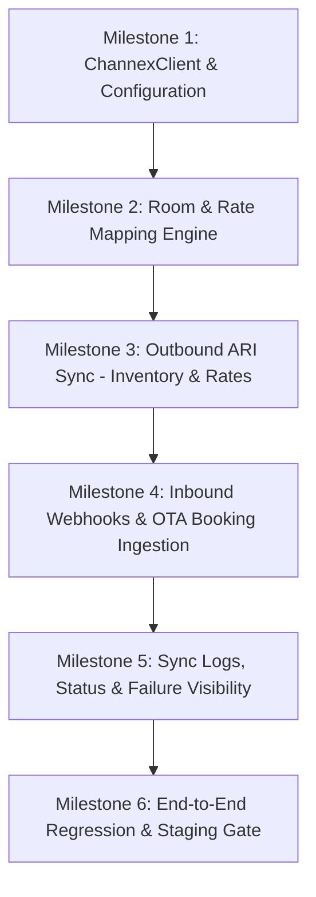

# HOTELMANTRI — PHASE 2: CHANNEX.IO CHANNEL MANAGER INTEGRATION PLAN

- **Role:** Senior Full-Stack Developer  
- **Date:** October 12, 2026  
- **Status:** Architecture Plan Ready for PM Approval  
- **Scope:** Channex.io Two-Way Channel Manager Integration  
- **Deliverable:** `PHASE_2_CHANNEX_IMPLEMENTATION_PLAN.md`  

---

## 1. Executive Summary

HotelMantri is transitioning from Phase 1 security remediation to **Phase 2: Channex.io Channel Manager Integration**. The objective is to establish a robust, bi-directional connection with [Channex.io](https://channex.io) to support automated distribution across online travel agencies (OTAs) including Booking.com, Agoda, Expedia, Airbnb, and MakeMyTrip.

The implementation will maximize reuse of existing PMS architecture:
- Authoritative local availability calculations and inventory lock safeguards.
- Existing database tables (`channel_connections`, `channel_rate_mappings`, `channel_ota_reservations`, `channel_inventory_restrictions`, `channel_sync_logs`, `channel_settings`).
- Complete React channel manager UI in `src/screens/channel/ChannelManager.tsx`.
- Idempotent reservation processing pipeline (`HotelMantriReservationService.js` and `withOtaLock`).

---

## 2. Existing Integration Status & Architecture Audit

### 2.1 Database Schema (Already Provisioned)
The initial database schema (`supabase/migrations/20260814000000_initial_schema.sql`) was originally drafted with Channex in mind:
- **`channel_connections`**: Stores connected OTA channels, connection status, last sync timestamp, and last error.
- **`channel_rate_mappings`**: Maps HotelMantri `room_category_id` and `rate_plan_id` to `channex_room_type_id` and `channex_rate_plan_id` (already has these dedicated columns).
- **`channel_ota_reservations`**: Stores inbound OTA bookings (`ota_booking_id`, guest name, amount, status, `raw_payload`, bound PMS `reservation_id`).
- **`channel_inventory_restrictions`**: Stores availability, base rate, channel rate, min/max stay, stop sell, closed to arrival (CTA), and closed to departure (CTD).
- **`channel_sync_logs`**: Comprehensive audit log recording direction (`inbound`/`outbound`), operation, status, message, and error details.
- **`channel_settings`**: Per-hotel configuration storing `api_base_url`, `api_key_secret_name`, `property_id`, `environment` (`test`/`production`), and `status`.

### 2.2 Frontend UI & Client Layer (Already Implemented)
- **`src/screens/channel/ChannelManager.tsx`**: Rich operational dashboard providing:
  - **Overview Tab:** Real-time sync statistics, connected channel health, and quick sync triggers.
  - **Channels Tab:** Channel management (activation, pausing, credentials).
  - **Mapping Tab:** Interactive room category and rate plan mapping matrix.
  - **Inventory & Rate Matrix:** Calendar grid displaying room availability, channel rates, and restriction toggles.
  - **Reservations Tab:** Filterable list of imported OTA bookings with PMS assignment status.
  - **Logs Tab:** Detailed sync event logs.
- **`src/lib/api-channel.ts`**: Complete client API layer already calling `/api/channels/*` endpoints.

### 2.3 Current Server State & Architectural Gap
- **Current Runtime Provider:** `server/routes/channels.js` currently invokes `aiosellService.js` and `routes/aiosell.js`.
- **Architectural Gap:** Channex.io operates on a JSON:API REST structure with specific endpoints (`/api/v1/availability`, `/api/v1/restrictions`, `/api/v1/booking_revisions`) and JSON webhook event signatures that differ from Aiosell's XML/JSON payload models.
- **Strategy:** Introduce a dedicated `server/services/integrations/channex/` integration package and multi-provider resolver in `providerConfig.js` without disrupting existing routes or test suites.

---

## 3. Channex.io API & Webhook Technical Specifications

Based on official Channex.io v1.0 REST API documentation:

### 3.1 Network & Authentication
- **Base URLs:**
  - Staging/Sandbox: `https://staging.channex.io/api/v1`
  - Production: `https://app.channex.io/api/v1`
- **Authentication Header:**
  ```http
  user-api-key: <CHANNEX_API_KEY>
  Content-Type: application/json
  ```

### 3.2 Core API Contracts

#### A. Property, Room Types & Rate Plans Discovery
- **Get Room Types:** `GET /api/v1/room_types?filter[property_id]=<PROPERTY_UUID>`  
  Returns array of room types (`id`, `title`, `count`, `occupancy`).
- **Get Rate Plans:** `GET /api/v1/rate_plans?filter[property_id]=<PROPERTY_UUID>`  
  Returns array of rate plans (`id`, `room_type_id`, `title`, `currency`, `rate_mode`).
- **Get Active Channels:** `GET /api/v1/channels?filter[property_id]=<PROPERTY_UUID>`  
  Returns connected OTA channels (Booking.com, Agoda, etc.).

#### B. Availability Push (Inventory ARI)
- **Endpoint:** `POST /api/v1/availability`
- **Payload Format:**
  ```json
  {
    "values": [
      {
        "property_id": "<PROPERTY_UUID>",
        "room_type_id": "<CHANNEX_ROOM_TYPE_UUID>",
        "date_from": "2026-11-01",
        "date_to": "2026-11-15",
        "availability": 8
      }
    ]
  }
  ```

#### C. Rates & Restrictions Push (Pricing ARI)
- **Endpoint:** `POST /api/v1/restrictions`
- **Payload Format:**
  ```json
  {
    "values": [
      {
        "property_id": "<PROPERTY_UUID>",
        "rate_plan_id": "<CHANNEX_RATE_PLAN_UUID>",
        "date_from": "2026-11-01",
        "date_to": "2026-11-15",
        "days": ["mo", "tu", "we", "th", "fr", "sa", "su"],
        "rate": "2499.00",
        "min_stay": 1,
        "max_stay": 0,
        "stop_sell": false,
        "closed_to_arrival": false,
        "closed_to_departure": false
      }
    ]
  }
  ```

#### D. Inbound Reservations & Revisions
- **Bookings Feed Query:** `GET /api/v1/bookings?filter[property_id]=<PROPERTY_UUID>`
- **Booking Revision Fetch:** `GET /api/v1/booking_revisions/:id`
  Returns normalized JSON:API object:
  - `data.attributes.ota_name`: Channel name (e.g. `BookingCom`, `Agoda`).
  - `data.attributes.ota_reservation_code`: Channel confirmation code.
  - `data.attributes.status`: `new`, `modified`, or `cancelled`.
  - `data.attributes.customer`: `{ name, surname, email, phone, ... }`.
  - `data.attributes.rooms`: Array of room segments with `room_type_id`, `rate_plan_id`, check-in/out, daily pricing, and guests.
  - `data.attributes.amount`: Total reservation value.

#### E. Webhook Event Notifications
- **Incoming Endpoint:** `POST /api/channex/webhook`
- **Supported Events:**
  - `booking_new`: New reservation creation.
  - `booking_modify`: Date/room/price modification.
  - `booking_cancelled`: Reservation cancellation.
  - `booking_unmapped_room` / `booking_unmapped_rate`: Alerts PMS when an OTA booking contains an unmapped rate plan/room type.
- **Webhook Security:** Webhook secret validation via timing-safe HMAC check (`x-channex-signature` header or configured bearer token).

---

## 4. Required Modules & File Structure

```
server/
├── services/
│   ├── integrations/
│   │   └── channex/
│   │       ├── ChannexClient.js              # Low-level HTTP client (timeout, auth, rate-limit, error parsing)
│   │       ├── ChannexMappingService.js       # Room type & rate plan discovery and mapping sync
│   │       ├── ChannexSyncService.js          # ARI push (availability and restrictions/rates)
│   │       ├── ChannexReservationService.js   # Booking revision transformation & PMS booking ingestion
│   │       └── ChannexWebhookController.js    # Express webhook handler (HMAC verification, idempotency)
│   ├── channexService.js                      # High-level facade mirroring aiosellService interface
│   └── providerConfig.js                      # Updated to resolve 'channex' vs 'aiosell' configs
├── routes/
│   ├── channex.js                             # Dedicated Channex webhook and test routes
│   └── channels.js                            # Updated to dispatch to provider based on hotel settings
scripts/
└── test_phase2_channex_integration.mjs        # Comprehensive Phase 2 test suite
```

---

## 5. Implementation Sequence

The implementation is broken into 6 focused, incremental milestones:



### Milestone 1: Channex Client & Config Foundation
- Implement `ChannexClient.js` with:
  - Base URL resolution (`staging.channex.io` vs `app.channex.io`).
  - Automatic `user-api-key` header attachment.
  - Request timeouts (15s default), retry on network blip (max 2 retries).
  - Safe error masking (never logging API keys).
- Add test connection action (`testConnection(config)` querying `GET /api/v1/properties/:id`).
- Register environment variables in `.env.example`: `CHANNEX_API_KEY`, `CHANNEX_BASE_URL`, `CHANNEX_WEBHOOK_SECRET`.

### Milestone 2: Room Category & Rate Plan Mapping
- Implement `ChannexMappingService.js`:
  - `fetchChannexCatalog(propertyId)`: Calls `room_types` and `rate_plans`.
  - Maps to PMS `room_categories` and `rate_plans`.
  - Persists mappings into `channel_rate_mappings` (storing `channex_room_type_id` and `channex_rate_plan_id`).
  - Identifies unmapped or orphaned rate plans with clear status badges.

### Milestone 3: Outbound ARI Sync (Inventory & Rates)
- Implement `ChannexSyncService.js`:
  - `pushInventory(hotelId, startDate, endDate)`:
    - Calculates authoritative inventory via PMS room count minus active bookings and maintenance blocks.
    - Formats payload according to `POST /api/v1/availability` (`values` array with `room_type_id`).
  - `pushRatesAndRestrictions(hotelId, startDate, endDate)`:
    - Fetches rates and restrictions from `channel_inventory_restrictions` / PMS pricing rules.
    - Formats payload for `POST /api/v1/restrictions` (`values` array with `rate_plan_id`, `rate`, `min_stay`, `stop_sell`, etc.).
  - Batches date ranges to adhere to Channex 10 req/min ARI limits.

### Milestone 4: Inbound Webhooks & OTA Booking Ingestion
- Implement `ChannexWebhookController.js`:
  - Route: `POST /api/channex/webhook`.
  - Authenticates request using timing-safe secret/signature check.
  - Fast ACK: Returns HTTP 200 within 1000ms, processing asynchronously or in-flow.
- Implement `ChannexReservationService.js`:
  - If payload contains `revision_id`, fetches full revision via `GET /api/v1/booking_revisions/:id`.
  - Normalizes guest details, dates, room segments, and OTA metadata.
  - Reuses `HotelMantriReservationService.js` and `withOtaLock` for strict idempotency.
  - Auto-assigns physical room or marks as 'Unassigned' without blocking booking import.
  - Handles modifications (`modified`) and cancellations (`cancelled`).
  - Dispatches PMS email/WhatsApp staff notifications if configured.

### Milestone 5: Sync Logs, Status & Failure Visibility
- Record all push and pull events into `channel_sync_logs` with structured error details.
- Update `channel_connections.last_sync_status` and `last_error` on failure.
- Expose clear error diagnostics in UI via existing `GET /api/channels/:channelId/logs` and `/sync/status`.
- Provide "Retry Failed Sync" and "Force Full Push" actions.

### Milestone 6: Verification & Test Suite
- Run automated integration suite (`test_phase2_channex_integration.mjs`).
- Verify all previous security regression suites (SEC-01 through SEC-10) remain 100% green.
- Verify Vite build and TypeScript checks pass cleanly.

---

## 6. Focused Test Plan

The test suite will be implemented in `scripts/test_phase2_channex_integration.mjs` using local mock HTTP responders (zero external network dependency):

| Test Category | Target Scenarios | Expected Behavior |
| :--- | :--- | :--- |
| **1. Channex Client & Auth** | - Valid `user-api-key`<br>- Invalid key / HTTP 401<br>- Network timeout | - Header properly attached<br>- Structured error returned<br>- No credential disclosure |
| **2. Room & Rate Mapping** | - Discover room types<br>- Discover rate plans<br>- Save mapping to DB | - Correct Channex UUID mapping<br>- Unmapped room alerts handled |
| **3. Inventory Push (ARI)** | - Multi-day availability push<br>- Zero-availability closeout<br>- Date range batching | - Valid `POST /api/v1/availability` payload<br>- Inventory lock respected |
| **4. Rate Push (ARI)** | - Base rates & channel rates<br>- Stop-sell & CTA/CTD flags<br>- Min stay rules | - Valid `POST /api/v1/restrictions` payload<br>- Rate limits observed |
| **5. Webhook Ingestion** | - Authentic webhook event<br>- Tampered signature<br>- Duplicate webhook retry | - HTTP 200 response<br>- HTTP 401 on bad signature<br>- Idempotent processing (no duplicate PMS booking) |
| **6. Booking Lifecycle** | - `new` booking import<br>- `modified` booking update<br>- `cancelled` booking release | - Creates PMS reservation<br>- Updates dates/room<br>- Releases room inventory |
| **7. Error Resilience** | - Channex 429 Rate Limit<br>- Channex 422 Validation Error | - Logged in `channel_sync_logs`<br>- UI error badge visible |

---

## 7. Dependencies, Configuration & Technical Blockers

### 7.1 Environment Variables Required (Template)
```env
# Channex.io Integration (Phase 2)
CHANNEX_BASE_URL=https://staging.channex.io/api/v1
CHANNEX_API_KEY=your_channex_api_key_here
CHANNEX_PROPERTY_ID=your_channex_property_uuid_here
CHANNEX_WEBHOOK_SECRET=your_channex_webhook_secret_here
CHANNEX_WEBHOOK_ENABLED=true
```

### 7.2 Practical Blockers & Notes
- **Staging Credentials:** Sandbox testing can run fully using simulated/mock Channex responses in the test suite. Actual staging integration requires a Channex staging API key and Property UUID.
- **Webhook Ingress in Staging:** Channex webhooks require a publicly reachable HTTPS endpoint. Staging environments deployed on Vercel/cloud will receive webhooks directly; local development uses mock webhook dispatch.
- **Provider Multi-Tenancy:** The implementation will ensure `aiosell` and `channex` can coexist seamlessly on a per-hotel basis without breaking existing test suites.

---

## 8. First Implementation Task

**Task 2.1: Channex HTTP Client & Connection Verification**
- Create `server/services/integrations/channex/ChannexClient.js`.
- Create `server/services/channexService.js` (initial facade with `testConnection`).
- Add provider resolution logic in `server/services/providerConfig.js` to support both `channex` and `aiosell`.
- Wire `POST /api/channels/test-connection` to test connectivity against Channex staging when provider is set to `channex`.
- Add test cases in `scripts/test_phase2_channex_integration.mjs` verifying connection success, authentication failure handling, and credential safety.

---

## 9. Verification & Gate Status

- **Production Deployment:** None (strictly local/test workspace).
- **Database Migrations:** None applied to production.
- **Secrets:** Zero secrets exposed.
- **Action Required:** Awaiting project-manager review and approval of this plan before executing Task 2.1.
