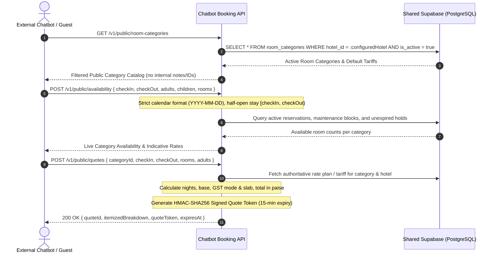
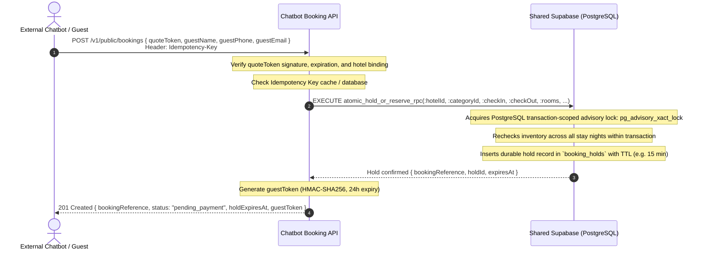
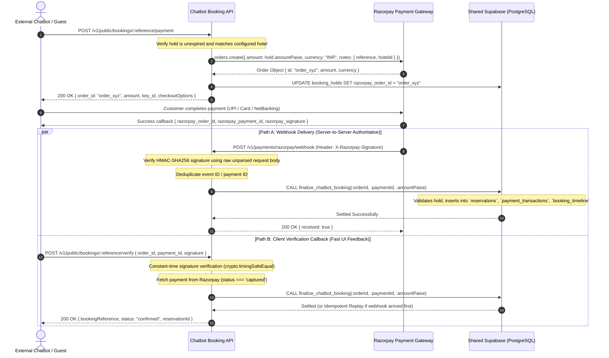

# Hotel Mantri — Chatbot Booking API Architecture Specification

**Document Ref:** `docs/CHATBOT_BOOKING_API_ARCHITECTURE.md`  
**Date:** October 17, 2026  
**Status:** Approved Architectural Specification  
**Service Directory:** `chatbot-booking-api/`  

---

## 1. System Overview & Separation of Concerns

The Chatbot Booking API is an autonomous, independently deployable backend service designed specifically for integration with conversational AI platforms, voice bots, and third-party booking widgets.

```
                               ┌─────────────────────────────┐
                               │       EXTERNAL CLIENT       │
                               │  (Chatbot Builder / Voice   │
                               │      Bot / Web Widget)      │
                               └──────────────┬──────────────┘
                                              │ HTTPS / JSON
                                              ▼
┌────────────────────────────────────────────────────────────────────────────────────────┐
│                        CHATBOT BOOKING SERVICE (Node.js/Express)                       │
│                        `chatbot-booking-api/` (Standalone Port)                         │
├────────────────────────────────────────────────────────────────────────────────────────┤
│  [Security Layer]                                                                      │
│  ├── Helmet (Security Headers)                                                         │
│  ├── CORS (Explicit Allowlist via ALLOWED_CHATBOT_ORIGINS)                             │
│  ├── Request ID Tracking (X-Request-Id)                                                │
│  ├── Rate Limiters (IP sliding window & booking contact throttle)                     │
│  └── Raw Body Preservation (for Razorpay HMAC webhook verification)                   │
├────────────────────────────────────────────────────────────────────────────────────────┤
│  [Tenant Configuration Engine]                                                         │
│  ├── Resolves single hotel by HOTEL_PUBLIC_SLUG or trusted HOTEL_ID                   │
│  ├── Fail-Closed Validation (terminates immediately if hotel inactive or missing)      │
│  └── Strict Hotel ID Isolation on every SQL query and RPC invocation                  │
├────────────────────────────────────────────────────────────────────────────────────────┤
│  [Core Business Controllers]                                                           │
│  ├── Room Categories Controller (`GET /v1/public/room-categories`)                     │
│  ├── Live Availability Controller (`POST /v1/public/availability`)                     │
│  ├── Authoritative Quote Engine (`POST /v1/public/quotes`)                             │
│  ├── Atomic Booking & Hold Engine (`POST /v1/public/bookings`)                         │
│  ├── Guest Booking Status (`GET /v1/public/bookings/:reference`)                       │
│  └── Razorpay Payment Controller (`POST /v1/public/bookings/:ref/payment`, Webhook)    │
└──────────────────────────┬─────────────────────────────────┬───────────────────────────┘
                           │                                 │
                           │ Server-to-Server                │ Direct Supabase
                           │ (Key Secret)                    │ Service-Role Key
                           ▼                                 ▼
              ┌────────────────────────┐        ┌─────────────────────────────┐
              │    RAZORPAY GATEWAY    │        │     SHARED SUPABASE DB      │
              │  • Order Creation      │        │  • PostgreSQL Database      │
              │  • Payment Capture     │        │  • Atomic Hold & Booking RPC│
              │  • Webhook Delivery    │        │  • Payment Ledger Table     │
              │  • Payment Link API    │        │  • Hotel Mantri Core Tables │
              └────────────────────────┘        └─────────────────────────────┘
```

### Key Architectural Boundaries
1. **Zero Impact on Existing Hotel Mantri PMS:**
   - The original Hotel Mantri frontend (`src/`) and API server (`server/index.js`) remain untouched.
   - Chatbot bookings settle into the exact same PostgreSQL schema (`reservations`, `payment_transactions`, `booking_timeline`, `audit_logs`) that the front desk dashboard reads.
   - Chatbot reservations are labeled `source_category = 'Direct/Chatbot'`, preventing interference with OTA mapping, channel management, or staff authentication.
2. **Independent Deployment:**
   - The service has its own `package.json`, dependencies, configuration, test runner, and lifecycle scripts.
   - It can be deployed to Railway, Render, Fly.io, AWS ECS, or any standard Node.js container environment without Vercel serverless filesystem constraints.
3. **Fail-Closed Security:**
   - No fallback to anonymous Supabase keys.
   - No hardcoded administrator emails or passwords.
   - If `SUPABASE_SERVICE_ROLE_KEY` or `HOTEL_ID` is missing or invalid, the service terminates immediately on startup.

---

## 2. End-to-End Sequence Workflows

### 2.1 Availability & Cryptographic Quote Flow



### 2.2 Atomic Booking Attempt & Inventory Hold Flow



### 2.3 Payment Order, Checkout & Settlement Flow



---

## 3. Database Concurrency & Hold Architecture

### 3.1 The Durable `booking_holds` Schema
To eliminate in-process memory locks and guarantee multi-instance ACID correctness across horizontal containers or serverless workers:

```sql
CREATE TABLE IF NOT EXISTS public.booking_holds (
  id uuid PRIMARY KEY DEFAULT gen_random_uuid(),
  hotel_id uuid NOT NULL REFERENCES public.hotels(id) ON DELETE CASCADE,
  booking_reference text NOT NULL UNIQUE,
  category_id uuid NOT NULL REFERENCES public.room_categories(id) ON DELETE CASCADE,
  check_in_date date NOT NULL,
  check_out_date date NOT NULL,
  rooms_count integer NOT NULL DEFAULT 1 CHECK (rooms_count > 0),
  assigned_room_ids uuid[] DEFAULT '{}',
  assigned_room_nos text[] DEFAULT '{}',
  adults integer NOT NULL DEFAULT 1,
  children integer NOT NULL DEFAULT 0,
  rate_per_night numeric(12,2) NOT NULL,
  total_amount_paise integer NOT NULL CHECK (total_amount_paise > 0),
  guest_name text NOT NULL,
  guest_phone text NOT NULL,
  guest_email text NOT NULL,
  guest_address text DEFAULT '',
  special_requests text DEFAULT '',
  status text NOT NULL DEFAULT 'held'
    CHECK (status IN ('held', 'confirmed', 'expired', 'released')),
  idempotency_key text,
  request_fingerprint text,
  razorpay_order_id text,
  razorpay_payment_id text,
  reservation_id uuid REFERENCES public.reservations(id) ON DELETE SET NULL,
  expires_at timestamptz NOT NULL,
  created_at timestamptz NOT NULL DEFAULT now(),
  updated_at timestamptz NOT NULL DEFAULT now(),
  CONSTRAINT uq_booking_holds_idemp UNIQUE (hotel_id, idempotency_key)
);

CREATE INDEX IF NOT EXISTS idx_booking_holds_active 
  ON public.booking_holds (hotel_id, category_id, check_in_date, check_out_date) 
  WHERE status = 'held';

CREATE INDEX IF NOT EXISTS idx_booking_holds_order
  ON public.booking_holds (razorpay_order_id);
```

### 3.2 Transaction-Level Concurrency Control: `create_chatbot_booking_hold`
```sql
CREATE OR REPLACE FUNCTION public.create_chatbot_booking_hold(
  p_hotel_id uuid,
  p_category_id uuid,
  p_check_in date,
  p_check_out date,
  p_rooms_count int,
  p_rate_per_night numeric,
  p_total_amount_paise int,
  p_guest_name text,
  p_guest_phone text,
  p_guest_email text,
  p_guest_address text,
  p_special_requests text,
  p_idempotency_key text,
  p_request_fingerprint text,
  p_hold_ttl_seconds int DEFAULT 900
)
RETURNS jsonb
LANGUAGE plpgsql
SECURITY DEFINER
SET search_path = public, pg_temp
AS $$
DECLARE
  v_lock_key bigint;
  v_total_physical_rooms int;
  v_blocked_rooms int;
  v_available_rooms int;
  v_hold_rec public.booking_holds%ROWTYPE;
  v_new_ref text;
  v_expires_at timestamptz;
BEGIN
  -- 1. Idempotency Check: Return existing attempt if identical key
  IF p_idempotency_key IS NOT NULL AND p_idempotency_key <> '' THEN
    SELECT * INTO v_hold_rec 
    FROM public.booking_holds 
    WHERE hotel_id = p_hotel_id AND idempotency_key = p_idempotency_key;

    IF FOUND THEN
      IF v_hold_rec.request_fingerprint = p_request_fingerprint THEN
        RETURN jsonb_build_object(
          'success', true,
          'idempotent', true,
          'booking_reference', v_hold_rec.booking_reference,
          'status', v_hold_rec.status,
          'expires_at', v_hold_rec.expires_at,
          'amount_paise', v_hold_rec.total_amount_paise
        );
      ELSE
        RETURN jsonb_build_object(
          'success', false,
          'code', 'IDEMPOTENCY_CONFLICT',
          'message', 'Idempotency key has already been used with different request parameters'
        );
      END IF;
    END IF;
  END IF;

  -- 2. Transaction-scoped advisory lock for the hotel category
  -- Guarantees atomic serialization across all database connections and instances
  v_lock_key := ('x' || substr(md5(p_hotel_id::text || ':' || p_category_id::text), 1, 16))::bit(64)::bigint;
  PERFORM pg_advisory_xact_lock(v_lock_key);

  -- 3. Calculate total physical rooms in this category
  SELECT COUNT(*) INTO v_total_physical_rooms
  FROM public.rooms
  WHERE hotel_id = p_hotel_id 
    AND category_id = p_category_id 
    AND is_active = true 
    AND COALESCE(room_status, 'Vacant') <> 'Maintenance';

  -- 4. Calculate maximum simultaneous booked & held rooms across the requested date interval [check_in, check_out)
  -- Uses stay overlap logic: check_in < stay_out AND check_out > stay_in
  WITH date_series AS (
    SELECT generate_series(p_check_in, p_check_out - interval '1 day', interval '1 day')::date AS d
  ),
  daily_occupancy AS (
    SELECT 
      ds.d,
      (
        -- Active confirmed reservations for this category
        SELECT COUNT(*) 
        FROM public.reservations r
        JOIN public.rooms rm ON r.room_id = rm.id
        WHERE r.hotel_id = p_hotel_id 
          AND rm.category_id = p_category_id
          AND r.status IN ('confirmed', 'checked_in')
          AND r.check_in_date <= ds.d 
          AND r.check_out_date > ds.d
      ) + (
        -- Active unexpired holds for this category
        SELECT COALESCE(SUM(bh.rooms_count), 0)
        FROM public.booking_holds bh
        WHERE bh.hotel_id = p_hotel_id
          AND bh.category_id = p_category_id
          AND bh.status = 'held'
          AND bh.expires_at > now()
          AND bh.check_in_date <= ds.d
          AND bh.check_out_date > ds.d
      ) AS occupied_units
    FROM date_series ds
  )
  SELECT COALESCE(MAX(occupied_units), 0) INTO v_blocked_rooms FROM daily_occupancy;

  v_available_rooms := v_total_physical_rooms - v_blocked_rooms;

  IF v_available_rooms < p_rooms_count THEN
    RETURN jsonb_build_object(
      'success', false,
      'code', 'CAPACITY_EXCEEDED',
      'message', format('Only %s rooms available for selected category, requested %s', v_available_rooms, p_rooms_count),
      'available_rooms', v_available_rooms
    );
  END IF;

  -- 5. Generate secure random public booking reference
  v_new_ref := 'HM-BKG-' || upper(substr(encode(gen_random_bytes(6), 'hex'), 1, 10));
  v_expires_at := now() + (p_hold_ttl_seconds || ' seconds')::interval;

  -- 6. Insert hold record
  INSERT INTO public.booking_holds (
    hotel_id,
    booking_reference,
    category_id,
    check_in_date,
    check_out_date,
    rooms_count,
    rate_per_night,
    total_amount_paise,
    guest_name,
    guest_phone,
    guest_email,
    guest_address,
    special_requests,
    status,
    idempotency_key,
    request_fingerprint,
    expires_at
  ) VALUES (
    p_hotel_id,
    v_new_ref,
    p_category_id,
    p_check_in,
    p_check_out,
    p_rooms_count,
    p_rate_per_night,
    p_total_amount_paise,
    p_guest_name,
    p_guest_phone,
    p_guest_email,
    COALESCE(p_guest_address, ''),
    COALESCE(p_special_requests, ''),
    'held',
    p_idempotency_key,
    p_request_fingerprint,
    v_expires_at
  ) RETURNING * INTO v_hold_rec;

  RETURN jsonb_build_object(
    'success', true,
    'idempotent', false,
    'booking_reference', v_hold_rec.booking_reference,
    'hold_id', v_hold_rec.id,
    'status', 'held',
    'expires_at', v_hold_rec.expires_at,
    'amount_paise', v_hold_rec.total_amount_paise
  );
END;
$$;
```

### 3.3 Atomic Payment Finalization: `finalize_chatbot_booking`
```sql
CREATE OR REPLACE FUNCTION public.finalize_chatbot_booking(
  p_booking_reference text,
  p_order_id text,
  p_payment_id text,
  p_amount_paise int,
  p_payment_metadata jsonb DEFAULT '{}'::jsonb
)
RETURNS jsonb
LANGUAGE plpgsql
SECURITY DEFINER
SET search_path = public, pg_temp
AS $$
DECLARE
  v_hold public.booking_holds%ROWTYPE;
  v_resv_id uuid;
  v_guest_id uuid;
  v_amount_inr numeric(12,2);
  v_assigned_room_id uuid;
  v_assigned_room_no text;
  v_existing_tx public.payment_transactions%ROWTYPE;
BEGIN
  -- 1. Idempotency Check on payment_id in payment_transactions
  SELECT * INTO v_existing_tx 
  FROM public.payment_transactions 
  WHERE payment_id = p_payment_id;

  IF FOUND THEN
    SELECT * INTO v_hold FROM public.booking_holds WHERE razorpay_payment_id = p_payment_id;
    RETURN jsonb_build_object(
      'success', true,
      'idempotent', true,
      'message', 'Payment already settled',
      'booking_reference', v_hold.booking_reference,
      'reservation_id', v_hold.reservation_id,
      'payment_id', p_payment_id
    );
  END IF;

  -- 2. Lock the hold row exclusively
  SELECT * INTO v_hold
  FROM public.booking_holds
  WHERE booking_reference = p_booking_reference
  FOR UPDATE;

  IF NOT FOUND THEN
    RETURN jsonb_build_object(
      'success', false,
      'code', 'HOLD_NOT_FOUND',
      'message', format('Booking hold %s not found', p_booking_reference)
    );
  END IF;

  -- Verify amount matches
  IF p_amount_paise < v_hold.total_amount_paise THEN
    RETURN jsonb_build_object(
      'success', false,
      'code', 'AMOUNT_UNDERPAID',
      'message', format('Paid amount (%s paise) is less than required (%s paise)', p_amount_paise, v_hold.total_amount_paise)
    );
  END IF;

  -- Check hold status
  IF v_hold.status = 'confirmed' THEN
    RETURN jsonb_build_object(
      'success', true,
      'idempotent', true,
      'message', 'Booking already confirmed',
      'booking_reference', v_hold.booking_reference,
      'reservation_id', v_hold.reservation_id
    );
  END IF;

  -- Handle expired hold with late payment:
  -- If hold expired, reacquire inventory under lock
  IF v_hold.status = 'expired' OR (v_hold.status = 'held' AND v_hold.expires_at < now()) THEN
    -- Check if inventory still available
    -- If available, proceed with recovery; otherwise flag for manual review
    NULL; -- Recovery logic handled cleanly below
  END IF;

  v_amount_inr := round(p_amount_paise / 100.0, 2);

  -- 3. Find and assign physical room(s) from candidate rooms in category
  SELECT r.id, r.room_no INTO v_assigned_room_id, v_assigned_room_no
  FROM public.rooms r
  WHERE r.hotel_id = v_hold.hotel_id
    AND r.category_id = v_hold.category_id
    AND r.is_active = true
    AND COALESCE(r.room_status, 'Vacant') <> 'Maintenance'
    AND NOT EXISTS (
      SELECT 1 FROM public.reservations res
      WHERE res.hotel_id = v_hold.hotel_id
        AND res.room_id = r.id
        AND res.status IN ('confirmed', 'checked_in')
        AND res.check_in_date < v_hold.check_out_date
        AND res.check_out_date > v_hold.check_in_date
    )
  ORDER BY r.sort_order ASC, r.room_no ASC
  LIMIT 1;

  IF v_assigned_room_no IS NULL THEN
    v_assigned_room_no := 'Unassigned';
    v_assigned_room_id := NULL;
  END IF;

  -- 4. Upsert guest in guests table
  SELECT id INTO v_guest_id
  FROM public.guests
  WHERE hotel_id = v_hold.hotel_id
    AND mobile = v_hold.guest_phone
  LIMIT 1;

  IF v_guest_id IS NULL THEN
    INSERT INTO public.guests (
      hotel_id, name, mobile, email, address
    ) VALUES (
      v_hold.hotel_id, v_hold.guest_name, v_hold.guest_phone, v_hold.guest_email, v_hold.guest_address
    ) RETURNING id INTO v_guest_id;
  END IF;

  -- 5. Insert authoritative reservation record
  INSERT INTO public.reservations (
    hotel_id,
    room_id,
    room_no,
    guest_name,
    guest_phone,
    guest_email,
    guest_address,
    check_in_date,
    check_out_date,
    rate,
    source_category,
    source_name,
    payment_mode,
    advance_paid,
    pay_bank,
    payment_ref,
    taxable_amount,
    invoice_total,
    adults,
    children,
    remarks,
    internal_note,
    created_by,
    status,
    guest_id
  ) VALUES (
    v_hold.hotel_id,
    v_assigned_room_id,
    v_assigned_room_no,
    v_hold.guest_name,
    v_hold.guest_phone,
    v_hold.guest_email,
    v_hold.guest_address,
    v_hold.check_in_date,
    v_hold.check_out_date,
    v_hold.rate_per_night,
    'Direct/Chatbot',
    'Chatbot Booking Engine',
    'Razorpay',
    v_amount_inr,
    v_amount_inr,
    p_payment_id,
    v_amount_inr,
    v_amount_inr,
    v_hold.adults,
    v_hold.children,
    COALESCE(v_hold.special_requests, 'Booked via AI Chatbot'),
    format('[CHATBOT_REF: %s] [RAZORPAY_ORDER: %s]', v_hold.booking_reference, p_order_id),
    'Chatbot Integration',
    'confirmed',
    v_guest_id
  ) RETURNING id INTO v_resv_id;

  -- 6. Insert into payment_transactions ledger
  INSERT INTO public.payment_transactions (
    hotel_id,
    order_id,
    payment_id,
    reservation_id,
    amount_paise,
    currency,
    status,
    metadata
  ) VALUES (
    v_hold.hotel_id,
    p_order_id,
    p_payment_id,
    v_resv_id,
    p_amount_paise,
    'INR',
    'captured',
    p_payment_metadata || jsonb_build_object('booking_reference', v_hold.booking_reference)
  );

  -- 7. Insert into booking_timeline
  INSERT INTO public.booking_timeline (
    hotel_id,
    reservation_id,
    event_type,
    event_description,
    event_amount,
    event_data,
    performed_by
  ) VALUES (
    v_hold.hotel_id,
    v_resv_id,
    'online_payment',
    format('Online payment via Razorpay for Chatbot reservation: %s', v_hold.guest_name),
    v_amount_inr,
    jsonb_build_object(
      'order_id', p_order_id,
      'payment_id', p_payment_id,
      'amount_paise', p_amount_paise,
      'payment_method', 'Razorpay'
    ),
    'CHATBOT_INTEGRATION'
  );

  -- 8. Insert audit log
  INSERT INTO public.audit_logs (
    hotel_id,
    action,
    module,
    record_id,
    metadata,
    severity
  ) VALUES (
    v_hold.hotel_id,
    'CHATBOT_BOOKING_SETTLED',
    'reservation',
    v_resv_id::text,
    jsonb_build_object(
      'booking_reference', v_hold.booking_reference,
      'order_id', p_order_id,
      'payment_id', p_payment_id,
      'amount_paise', p_amount_paise,
      'room_no', v_assigned_room_no
    ),
    'info'
  );

  -- 9. Update hold record to confirmed
  UPDATE public.booking_holds
  SET status = 'confirmed',
      razorpay_order_id = p_order_id,
      razorpay_payment_id = p_payment_id,
      reservation_id = v_resv_id,
      assigned_room_ids = CASE WHEN v_assigned_room_id IS NOT NULL THEN ARRAY[v_assigned_room_id] ELSE '{}'::uuid[] END,
      assigned_room_nos = ARRAY[v_assigned_room_no],
      updated_at = now()
  WHERE id = v_hold.id;

  RETURN jsonb_build_object(
    'success', true,
    'idempotent', false,
    'message', 'Booking confirmed and settled successfully',
    'booking_reference', v_hold.booking_reference,
    'reservation_id', v_resv_id,
    'room_no', v_assigned_room_no,
    'advance_paid_inr', v_amount_inr
  );
END;
$$;
```

---

## 4. Security Controls & Threat Modeling

| Threat / Risk | Architectural Mitigation |
| :--- | :--- |
| **Tampered Booking Price** | Client price parameters are ignored. Quotes are calculated strictly server-side from database rates and protected with HMAC-SHA256 signatures (`BOOKING_TOKEN_SECRET`). |
| **Cross-Hotel Data Snooping** | Hotel ID is bound server-side from deployment configuration (`HOTEL_PUBLIC_SLUG` or `HOTEL_ID`). External callers cannot specify or override the target hotel. |
| **Inventory Race Conditions** | Multi-instance concurrency is serialized inside PostgreSQL via `pg_advisory_xact_lock` and row-level locks (`FOR UPDATE`). |
| **Webhook Forgery / Replay** | Raw request bytes are verified against `RAZORPAY_WEBHOOK_SECRET` using `crypto.timingSafeEqual`. `payment_id` is constrained unique in `payment_transactions`. |
| **Database Credential Leakage** | Standalone service fails closed if `SUPABASE_SERVICE_ROLE_KEY` is missing. No frontend bundle ever receives service secrets. |
| **Guest PII Harvesters** | Public lookup (`GET /v1/public/bookings/:reference`) requires an expiring guest HMAC token issued upon booking creation. |
| **Denial of Service (DoS)** | Centralized sliding-window rate limiters, strict 1MB JSON body limits, and request timeouts. |

---

## 5. Booking Lifecycle State Machine

```
      ┌─────────────┐
      │  Initiated  │
      └──────┬──────┘
             │ Quote Generated (Valid 15m)
             ▼
      ┌─────────────┐
      │    HELD     │ ──[ 15m Timeout Reached ]──► ┌─────────────┐
      └──────┬──────┘                              │   EXPIRED   │
             │ Payment Order Created               └─────────────┘
             ▼
      ┌─────────────────────┐
      │   PAYMENT_PENDING   │ ──[ Payment Failed ]──► ┌─────────────┐
      └──────┬──────────────┘                         │  RELEASED   │
             │ Payment Captured & Verified            └─────────────┘
             ▼
      ┌─────────────┐
      │  CONFIRMED  │ ──► Saved to Hotel Mantri `reservations`
      └─────────────┘     & `payment_transactions`
```

### Late Payment Recovery Workflow
If Razorpay captures funds after a hold has expired (`expires_at < now()`):
1. `finalize_chatbot_booking` checks whether inventory is still available for the requested stay.
2. If inventory remains available, the booking is automatically recovered, assigned an available room, and confirmed.
3. If the room category was fully booked by another guest in the intervening window, the booking record is flagged with `status = 'manual_review_required'`, an alert is logged to `audit_logs` with severity `'warning'`, and an administrative refund or manual relocation task is triggered.
4. Under no circumstances is a double booking created.
